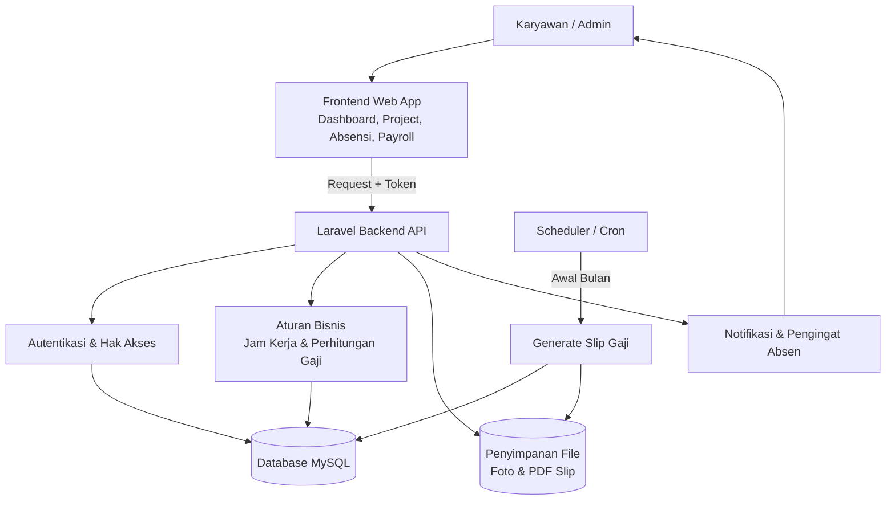
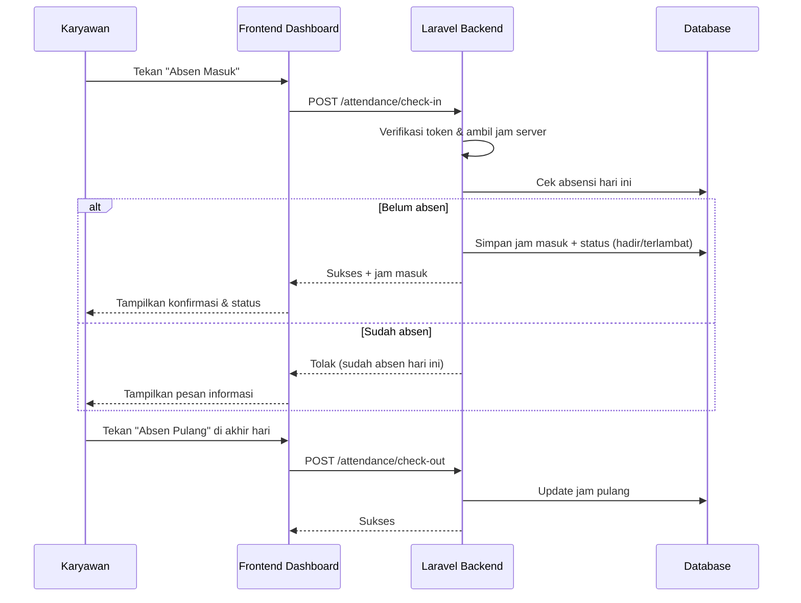
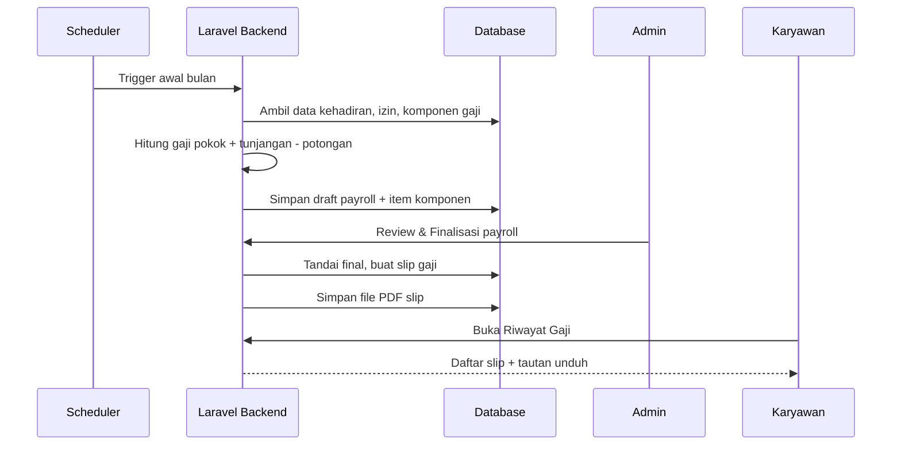
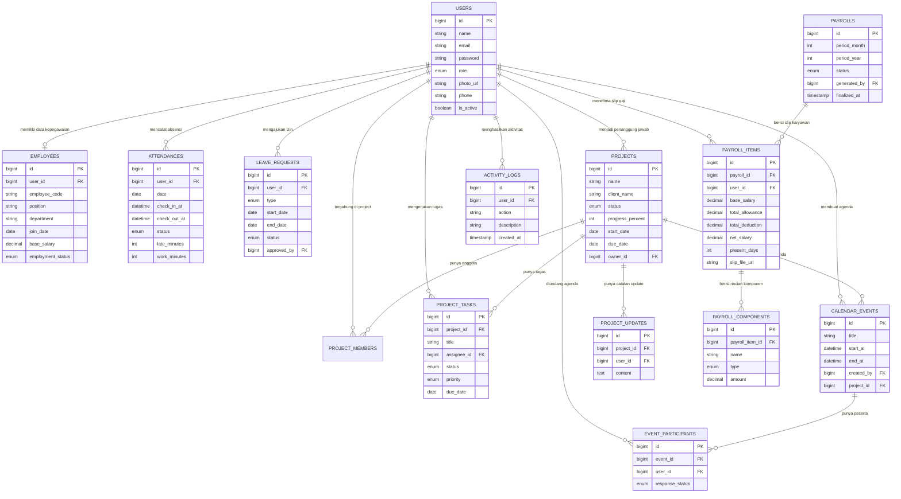

# PRD — Project Requirements Document

## 1. Overview

**Masalah yang diselesaikan**

Studio arsitektur saat ini menjalankan tiga hal penting secara manual dan tersebar: progres project dicatat di tempat berbeda-beda (chat, spreadsheet, catatan pribadi), kehadiran karyawan dicatat secara manual sehingga rawan salah rekap, dan penggajian dihitung lalu ditransfer satu per satu setiap bulan. Akibatnya admin studio menghabiskan banyak waktu untuk pekerjaan administratif, sementara karyawan tidak punya gambaran jelas tentang pekerjaan, jadwal, dan hak gajinya.

**Tujuan utama aplikasi**

Membuat satu dashboard karyawan berbasis web yang menyatukan tiga kebutuhan inti studio arsitektur:

1. **Tracking project** — semua project yang berjalan terlihat progresnya dalam satu tempat.
2. **Absensi harian** — karyawan mencatat masuk dan pulang dengan sekali tekan, rekapnya otomatis.
3. **Payroll gaji** — slip gaji dibuat otomatis setiap bulan dan bisa diunduh karyawan.

**Target pengguna**

Karyawan dan admin studio arsitektur (skala kecil–menengah, sekitar 5–50 orang). Dua peran utama: **Karyawan** (absen, lihat project & tugas, lihat slip gaji, lihat kalender tim) dan **Admin studio** (mengelola project, absensi, jadwal, dan payroll seluruh tim).

**Nilai utama**

"Semua jadi satu tempat." Alasan karyawan kembali membuka aplikasi setiap hari adalah **absen pagi** — satu kebiasaan sederhana yang menjadi pintu masuk ke seluruh fitur lainnya. Halaman pertama yang dilihat adalah **Ringkasan Hari Ini**, yang langsung memperlihatkan kondisi hari itu dalam satu layar.

---

## 2. Requirements

**Persyaratan fungsional utama**

- Aplikasi berbasis web yang bisa diakses dari laptop dan ponsel (responsif), karena absensi dilakukan karyawan di pagi hari sering lewat ponsel.
- Tiga modul inti wajib tersedia: **Tracking Project**, **Absensi Harian**, dan **Payroll / Slip Gaji Otomatis**.
- Dashboard utama menampilkan ringkasan hari ini: angka penting, agenda, aktivitas terbaru, dan pintasan cepat.
- Absensi masuk/pulang mampu mencatat waktu secara otomatis dan menandai keterlambatan berdasarkan jam kerja studio.
- Payroll mampu menghitung gaji pokok, tunjangan, dan potongan (termasuk potongan keterlambatan/ketidakhadiran) lalu menghasilkan slip gaji bulanan yang bisa diunduh.
- Terdapat kalender tim untuk melihat dan membuat agenda bersama.
- Ada peran dan hak akses berbeda antara karyawan biasa dan admin studio.

**Persyaratan non-fungsional**

- Antarmuka bersih, modern, dan mudah dipahami karyawan non-teknis (mirip gaya dashboard referensi: kartu statistik, panel kalender, daftar aktivitas).
- Waktu absensi harus akurat dan konsisten (memakai satu zona waktu studio, mis. WIB).
- Data gaji bersifat sensitif: hanya pemilik slip dan admin yang dapat melihat.
- Riwayat absensi dan slip gaji tersimpan permanen dan bisa ditelusuri minimal 12 bulan ke belakang.
- Halaman utama harus cepat dimuat (target < 3 detik) karena menjadi kebiasaan harian.
- Adanya jejak audit sederhana untuk perubahan data payroll.

**Batasan**

- Fase awal tidak mencakup integrasi transfer bank otomatis; payroll menghasilkan slip dan rekap, pencairan tetap dilakukan admin.
- Tidak ada aplikasi mobile native di versi awal; cukup web responsif.

---

## 3. Core Features

Fitur disusun mengikuti kerangka roadmap yang sudah disetujui, dikelompokkan per fase.

### Fase 1 — Fondasi Dashboard

**Ringkasan Hari Ini** — Halaman utama yang langsung memperlihatkan kondisi hari ini dalam satu layar.
- **Kartu Angka Penting** — Menampilkan angka ringkas seperti jumlah hadir, project aktif, dan agenda hari ini.
- **Agenda Hari Ini** — Daftar kegiatan dan jadwal terdekat yang harus dijalani hari ini.
- **Aktivitas Terbaru** — Kabar terkini dari tim, seperti update project dan absensi anggota.
- **Pintasan Cepat** — Tombol cepat untuk langsung absen, buka project, atau lihat slip gaji.

### Fase 2 — Operasional Harian Tim

**Tracking Project** — Memantau semua project yang sedang berjalan beserta progresnya.
- **Daftar Project Berjalan** — Melihat semua project aktif beserta status dan penanggung jawabnya.
- **Detail & Progres Project** — Membuka satu project untuk melihat tahapan, tenggat, dan persentase selesai.
- **Tugas Tim** — Melihat dan memperbarui tugas tiap anggota di dalam project.
- **Catatan & Update** — Menambahkan kabar perkembangan terbaru agar semua tim tahu kondisi project.

**Absensi Harian** — Mencatat kehadiran masuk dan pulang tanpa lagi manual.
- **Absen Masuk** — Menandai kehadiran saat mulai bekerja dengan sekali tekan.
- **Absen Pulang** — Menandai waktu selesai bekerja di akhir hari.
- **Riwayat Kehadiran** — Melihat catatan hadir, terlambat, dan tidak masuk di hari-hari sebelumnya.
- **Pengajuan Izin** — Mengirim permohonan izin atau cuti langsung dari aplikasi.

**Kalender Tim** — Melihat jadwal dan agenda seluruh tim dalam satu tampilan kalender.
- **Tampilan Kalender** — Melihat jadwal dalam tampilan bulanan atau mingguan yang mudah dibaca.
- **Jadwal per Anggota** — Menyaring kalender untuk melihat agenda orang tertentu saja.
- **Detail Agenda** — Membuka satu jadwal untuk melihat waktu, tempat, dan pesertanya.
- **Tambah Jadwal** — Membuat agenda atau pertemuan baru untuk tim.

### Fase 3 — Payroll Otomatis

**Slip Gaji Otomatis** — Gaji dan slip gaji dibuat otomatis, tidak lagi dihitung manual.
- **Slip Gaji Bulanan** — Melihat slip gaji yang sudah dibuat otomatis setiap bulan.
- **Rincian Komponen Gaji** — Menjelaskan gaji pokok, tunjangan, potongan, dan total yang diterima.
- **Unduh Slip** — Menyimpan atau mengunduh slip gaji untuk keperluan pribadi.
- **Riwayat Gaji** — Melihat daftar gaji bulan-bulan sebelumnya dalam satu tempat.

### Fase 4 — Akun & Akses

**Akun & Akses** — Masuk ke aplikasi dan mengatur data pribadi serta hak akses.
- **Masuk Akun** — Masuk ke aplikasi memakai akun kantor yang sudah diberikan.
- **Kelola Profil** — Memperbarui nama, foto, dan kontak pribadi.
- **Atur Hak Akses** — Membedakan tampilan untuk karyawan biasa dan admin studio.
- **Ganti Kata Sandi** — Mengganti kata sandi agar akun tetap aman.

---

## 4. User Flow

**A. Alur harian karyawan (Fase 1 & 2)**

1. Karyawan membuka aplikasi pagi hari dan langsung mendarat di **Ringkasan Hari Ini**.
2. Karyawan melihat kartu angka penting: jumlah hadir, project aktif, dan jumlah agenda hari ini.
3. Karyawan menekan **Pintasan Cepat → Absen** (atau menu Absensi), lalu menekan **Absen Masuk**. Sistem mencatat jam masuk dan menandai status hadir/terlambat.
4. Karyawan kembali ke dashboard, melihat **Agenda Hari Ini** dan **Aktivitas Terbaru** dari tim.
5. Karyawan membuka **Tracking Project**, memilih project yang diikuti, melihat progres dan daftar tugasnya, lalu memperbarui status tugas atau menambahkan **Catatan & Update**.
6. Karyawan membuka **Kalender Tim** untuk memeriksa jadwal rapat hari ini atau minggu ini, dan bila perlu menambahkan agenda baru.
7. Di akhir hari, karyawan menekan **Absen Pulang**. Jam pulang tercatat.

**B. Alur pengajuan izin (Fase 2)**

1. Karyawan membuka **Absensi → Pengajuan Izin**.
2. Karyawan mengisi tanggal, jenis izin (izin/cuti/sakit), dan keterangan, lalu mengirim.
3. Admin menerima pengajuan, menyetujui atau menolak.
4. Status izin tampil pada **Riwayat Kehadiran** dan tercatat sebagai dasar perhitungan payroll.

**C. Alur admin studio bulanan (Fase 3)**

1. Admin membuka **Payroll**, memilih periode bulan berjalan.
2. Sistem otomatis menarik data kehadiran, izin, dan komponen gaji tiap karyawan untuk menghitung gaji pokok + tunjangan − potongan.
3. Admin memeriksa hasil perhitungan, melakukan penyesuaian bila perlu, lalu menekan **Finalisasi Payroll**.
4. Slip gaji terbit otomatis untuk setiap karyawan.
5. Karyawan masuk ke **Slip Gaji → Riwayat Gaji**, membuka slip bulan tersebut, melihat rincian komponen, lalu mengunduhnya.

**D. Alur akun (Fase 4)**

1. Karyawan menerima akun kantor, masuk melalui halaman **Masuk Akun**.
2. Karyawan melengkapi **Kelola Profil** dan mengganti kata sandi awal.
3. Sistem menampilkan menu & data sesuai **hak akses**: karyawan hanya melihat data pribadi, admin melihat seluruh tim.

---

## 5. Architecture

Aplikasi dibangun sebagai aplikasi web terpusat: satu backend Laravel yang melayani API dan halaman, satu database relasional sebagai sumber kebenaran data (project, absensi, payroll), serta frontend modern yang mengambil data dari backend. Semua perhitungan sensitif (status keterlambatan, perhitungan gaji) dilakukan di sisi server agar konsisten dan tidak bisa dimanipulasi dari browser.

**Lapisan sistem**

- **Frontend (Web App)** — antarmuka dashboard, project, absensi, kalender, payroll. Bertanggung jawab pada tampilan dan interaksi.
- **Backend (Laravel API + Auth)** — mengatur autentikasi, hak akses (karyawan vs admin), validasi, aturan bisnis absensi (jam kerja, terlambat), dan perhitungan payroll.
- **Database (MySQL)** — menyimpan seluruh data master dan transaksi.
- **Penyimpanan File** — untuk foto profil dan file slip gaji (PDF).
- **Scheduler / Queue** — tugas terjadwal untuk pembuatan slip gaji otomatis tiap awal bulan dan pengingat absen.

**Diagram alur utama**

**Alur absensi (sequence)**

**Alur payroll bulanan**

**Catatan arsitektur**

- Semua waktu memakai zona waktu studio yang dikonfigurasi di server, bukan waktu perangkat pengguna.
- Perhitungan payroll disimpan sebagai **item komponen** (bukan satu angka), agar rincian slip selalu bisa dipertanggungjawabkan dan diaudit.
- Data payroll bersifat append-only setelah difinalisasi; perubahan hanya lewat penyesuaian tercatat.

---

## 6. Database Schema

Berikut tabel-tabel utama beserta field penting, tipe, dan kegunaannya.

**users** — akun login seluruh pengguna
- `id` (bigint, PK)
- `name` (string) — nama lengkap
- `email` (string, unique) — email kantor untuk login
- `password` (string) — kata sandi terenkripsi
- `role` (enum: admin, employee) — hak akses
- `photo_url` (string, nullable) — foto profil
- `phone` (string, nullable) — kontak pribadi
- `is_active` (boolean) — status akun
- `created_at`, `updated_at` (timestamp)

**employees** — data kepegawaian karyawan
- `id` (bigint, PK)
- `user_id` (bigint, FK → users.id)
- `employee_code` (string, unique) — nomor induk karyawan
- `position` (string) — jabatan (arsitek, drafter, admin, dsb.)
- `department` (string, nullable) — divisi
- `join_date` (date) — tanggal bergabung
- `base_salary` (decimal) — gaji pokok
- `employment_status` (enum: tetap, kontrak, magang)
- `created_at`, `updated_at`

**projects** — project yang dikelola studio
- `id` (bigint, PK)
- `name` (string) — nama project
- `client_name` (string, nullable) — nama klien
- `description` (text, nullable)
- `status` (enum: planning, ongoing, review, done, on_hold)
- `progress_percent` (integer 0–100) — persentase selesai
- `start_date` (date), `due_date` (date) — tenggat
- `owner_id` (bigint, FK → users.id) — penanggung jawab
- `created_at`, `updated_at`

**project_members** — anggota tim tiap project
- `id` (bigint, PK)
- `project_id` (bigint, FK → projects.id)
- `user_id` (bigint, FK → users.id)
- `role_in_project` (string, nullable) — peran di project
- `created_at`

**project_tasks** — tugas di dalam project
- `id` (bigint, PK)
- `project_id` (bigint, FK → projects.id)
- `title` (string) — nama tugas
- `description` (text, nullable)
- `assignee_id` (bigint, FK → users.id, nullable)
- `status` (enum: todo, in_progress, review, done)
- `priority` (enum: low, medium, high)
- `due_date` (date, nullable)
- `completed_at` (timestamp, nullable)
- `created_at`, `updated_at`

**project_updates** — catatan perkembangan project
- `id` (bigint, PK)
- `project_id` (bigint, FK → projects.id)
- `user_id` (bigint, FK → users.id) — penulis update
- `content` (text) — isi kabar perkembangan
- `created_at`

**attendances** — catatan absensi harian
- `id` (bigint, PK)
- `user_id` (bigint, FK → users.id)
- `date` (date) — tanggal absensi
- `check_in_at` (datetime, nullable) — jam masuk
- `check_out_at` (datetime, nullable) — jam pulang
- `status` (enum: hadir, terlambat, izin, sakit, cuti, alpha)
- `late_minutes` (integer, default 0) — menit keterlambatan
- `work_minutes` (integer, nullable) — durasi kerja
- `notes` (text, nullable)
- `created_at`, `updated_at`
- *unique constraint: (user_id, date)*

**leave_requests** — pengajuan izin/cuti
- `id` (bigint, PK)
- `user_id` (bigint, FK → users.id)
- `type` (enum: izin, cuti, sakit)
- `start_date` (date), `end_date` (date)
- `reason` (text)
- `status` (enum: pending, approved, rejected)
- `approved_by` (bigint, FK → users.id, nullable)
- `approved_at` (timestamp, nullable)
- `created_at`, `updated_at`

**calendar_events** — agenda dan jadwal tim
- `id` (bigint, PK)
- `title` (string) — nama agenda
- `description` (text, nullable)
- `location` (string, nullable)
- `start_at` (datetime), `end_at` (datetime)
- `created_by` (bigint, FK → users.id)
- `project_id` (bigint, FK → projects.id, nullable) — terkait project bila ada
- `created_at`, `updated_at`

**event_participants** — peserta agenda
- `id` (bigint, PK)
- `event_id` (bigint, FK → calendar_events.id)
- `user_id` (bigint, FK → users.id)
- `response_status` (enum: invited, accepted, declined, default invited)

**payrolls** — periode gaji bulanan
- `id` (bigint, PK)
- `period_month` (integer 1–12), `period_year` (integer)
- `status` (enum: draft, finalized, paid)
- `generated_by` (bigint, FK → users.id)
- `finalized_at` (timestamp, nullable)
- `created_at`, `updated_at`
- *unique constraint: (period_month, period_year)*

**payroll_items** — slip gaji per karyawan per periode
- `id` (bigint, PK)
- `payroll_id` (bigint, FK → payrolls.id)
- `user_id` (bigint, FK → users.id)
- `base_salary` (decimal) — gaji pokok
- `total_allowance` (decimal) — total tunjangan
- `total_deduction` (decimal) — total potongan
- `net_salary` (decimal) — gaji bersih diterima
- `present_days` (integer) — jumlah hari hadir
- `absent_days` (integer) — jumlah tidak masuk
- `slip_file_url` (string, nullable) — lokasi file PDF slip
- `created_at`, `updated_at`

**payroll_components** — rincian komponen gaji
- `id` (bigint, PK)
- `payroll_item_id` (bigint, FK → payroll_items.id)
- `name` (string) — mis. "Tunjangan Transport", "Potongan Keterlambatan"
- `type` (enum: allowance, deduction)
- `amount` (decimal)
- `note` (string, nullable)

**activity_logs** — aktivitas terbaru untuk dashboard
- `id` (bigint, PK)
- `user_id` (bigint, FK → users.id)
- `action` (string) — mis. "check_in", "task_updated", "project_update"
- `reference_type` (string, nullable), `reference_id` (bigint, nullable) — objek terkait
- `description` (string) — teks ringkas untuk ditampilkan
- `created_at`

**Diagram ER**

---

## 7. Tech Stack

Karena backend sudah ditentukan **Laravel**, frontend dipilih agar tetap satu ekosistem dan tidak menambah beban operasional (tidak perlu dua server terpisah).

**Frontend**
- **React + TypeScript** dengan **Inertia.js** — menyatukan kenyamanan React dengan routing Laravel tanpa perlu membangun API terpisah.
- **Tailwind CSS** — mempercepat pembuatan tampilan dashboard yang bersih dan responsif, sesuai gaya visual referensi (kartu statistik, panel kalender, daftar aktivitas).
- **shadcn/ui** — komponen siap pakai (card, table, dialog, tabs, calendar) yang konsisten dan mudah disesuaikan.
- **Recharts** — grafik tren sederhana pada kartu angka penting.

**Backend**
- **Laravel 11** — autentikasi, hak akses (middleware role), validasi, penjadwalan (task scheduler), dan antrean (queue) untuk pembuatan slip gaji.
- **Laravel Breeze / Laravel Fortify** — fondasi autentikasi dan ganti kata sandi.
- **Laravel Scheduler** — pembuatan draft payroll otomatis tiap awal bulan dan pengingat absen.

**Database**
- **MySQL 8** — relasional, andal untuk data transaksi absensi dan payroll, mudah dikelola di hosting umum.
- **Redis** (opsional, fase lanjut) — cache dashboard dan antrean job.

**File & Dokumen**
- **Laravel Storage (lokal / S3-compatible)** — foto profil dan file slip gaji.
- **DomPDF / Laravel Snappy** — menghasilkan slip gaji dalam format PDF.

**Deployment**
- **VPS (mis. 2 vCPU / 4 GB RAM) + Docker Compose** — menampung aplikasi web, MySQL, dan worker antrean dalam satu server; biaya rendah dan mudah di-backup.
- **Nginx + HTTPS (Let's Encrypt)** — web server dan keamanan koneksi.
- **Laravel Forge / GitHub Actions** — otomatisasi deploy dari repositori dan backup harian database.

**Pendukung**
- **Zona waktu & lokal Indonesia** dikonfigurasi di server (WIB/WITA/WIT) agar jam absensi akurat.
- **Sentry** (opsional) — pemantauan error agar masalah absensi/payroll cepat terdeteksi.